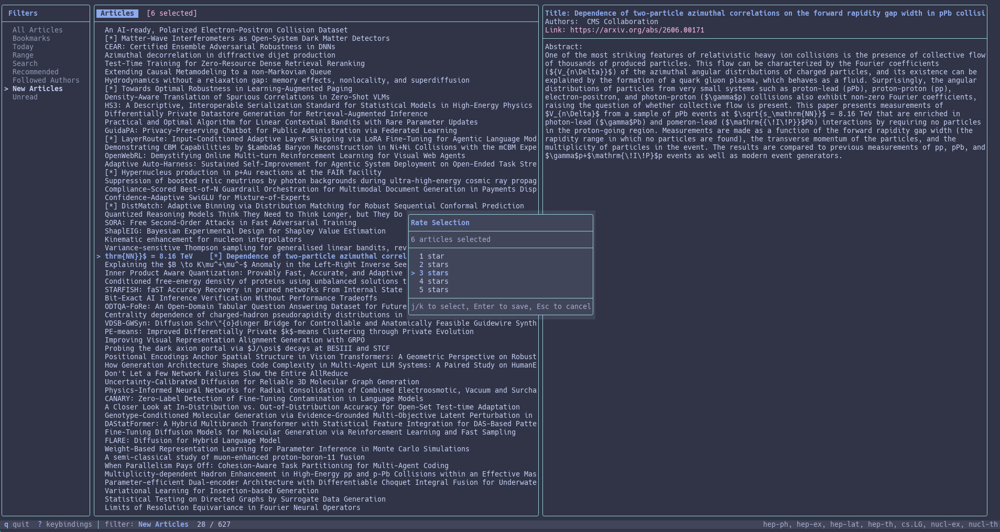

# arxiv-tui

[](https://github.com/jxi24/arxiv-tui/actions/workflows/ci.yml)
[](https://github.com/jxi24/arxiv-tui/actions/workflows/sanitizers.yml)
[](https://github.com/jxi24/arxiv-tui/actions/workflows/static-analysis.yml)
[](https://codecov.io/gh/jxi24/arxiv-tui)
[](https://api.reuse.software/info/github.com/jxi24/arxiv-tui)

A keyboard-driven terminal user interface for browsing, managing, and downloading arXiv research papers — built in C++17 with [FTXUI](https://github.com/ArthurSonzogni/FTXUI). An optional desktop window (`arxiv-gui`) works on the same papers, settings and database.

---

## Features

- **Live feed fetching** — pulls articles from arXiv RSS feeds for any set of categories
- **Local persistence** — stores articles in a SQLite database so they remain available offline
- **Views** — All Articles, Bookmarks, Today (the latest arXiv mailing — Friday's over the weekend), New Articles (everything stored since your last session, including days you missed), Updated, Unread, Followed Authors, a date range, search, Recommended, and every tag and project; the filter pane shows how many papers each holds
- **Full-text search** — search titles, authors, abstracts, or any combination
- **Fuzzy search** — when nothing matches exactly, near misses are shown
- **Author subscriptions** — `f` follows or unfollows the focused paper's authors or a typed name; Followed Authors lists their papers
- **Bookmarks** — mark papers for later reading; bulk-bookmark multiple articles at once
- **Multi-article selection** — select articles with `Space`, then apply bulk actions: bookmark, add to project, or delete
- **Article deletion** — remove individual articles or entire selections from the local database
- **Projects** — group related articles into named collections with sub-projects, per-article notes, and export/import (Markdown, plain text, BibTeX, JSON — the JSON keeps sub-project parents, tags and ratings)
- **Tags** — `#` toggles tags on the focused paper or the selection, creates and deletes them
- **Rename and move** — `E` renames a project or tag (papers, notes and an exported `.bib` follow); `M` moves a project under another one
- **Mouse support** — click views and articles, scroll with the wheel
- **PDF download** — fetch papers directly to a configurable local directory; downloads and exports run in the background with a progress badge, so the TUI never freezes
- **Configurable key bindings** — remap every action via a YAML file or the Settings dialog
- **Settings dialog** — `S` edits every option in the app; changes apply at once (topics on the next start), `q` cancels
- **Themes** — `frappe` (default), `latte`, `mocha`, `high-contrast` or `terminal`, with per-colour overrides
- **Configurable article list columns** — choose which columns appear in the article list (title, authors, date, category, score, id) and in what order via `article_columns` in `config.yml`
- **Scrolling detail pane** — read full titles and abstracts without leaving the terminal
- **Personalised ranking** — rate articles 1–5 stars with `n`; bulk-rate an entire selection with `W`; a lightweight neural network learns your preferences and surfaces today's most relevant papers in the Recommended filter
- **Open in browser** — press `O` to open the focused article (or all selected articles) directly in the system default browser via `xdg-open`
- **BibTeX export** — generate `.bib` files for individual articles, selections, or entire projects, with automatic InspireHEP lookup and metadata fallback
- **Read/unread tracking** — articles are marked read when the detail pane opens, when you navigate while the detail pane is open, or when a PDF is downloaded; read articles render dimmer so unread papers stand out; an **Unread** filter shows everything not yet read
- **Auto-refresh** — configurable background feed refresh interval (0 = disabled); when arXiv cannot be reached the footer says so and the stored papers stay available
- **`--fetch` headless mode** — `arxiv-tui --fetch` updates the database and exits without opening the TUI, enabling cron-based refresh; papers it stores still show as new in the next session
- **Headless digests** — `--export-today` writes the latest mailing as Markdown and `--export-yaml` as YAML ranked by your ratings and keywords, ready for other tools
- **Database pruning** — optional `max_article_age_days` config key automatically removes old articles on startup unless they are bookmarked, rated, or in a project
- **Replay system and crash handler** — all UI actions are recorded to a JSONL replay log; on a crash, a report with backtrace and full replay is saved for debugging
- **Link deduplication** — incoming RSS and Atom feeds are normalised to a canonical URL form on ingestion, and any existing duplicates are cleaned up automatically on first run
- **Undo delete** — press `u` to restore the last deleted article (or entire bulk-deleted selection) including its rating, project memberships, notes, and tags; a configurable ring buffer (default 10 steps) keeps the last N operations available for undo
- **Help overlay search** — type while the `?` overlay is open to filter key bindings in real time; Backspace trims the query, Escape clears it, a second Escape closes the overlay
- **Export digest as archive** — `G` packs the selected-articles digest (Markdown + PDFs) into a portable `.tar.gz` file
- **Desktop GUI** — optional `arxiv-gui` window (Dear ImGui) with the same views, search, ratings, tags, projects and downloads; dark theme, and icons when a Nerd Font is installed
- **Careful with your files** — every file the app writes is written atomically (a full disk never leaves a half-written config or export); the database, logs and replay log are private to you (mode 0600); external programs are started without a shell; network responses, redirects and API paging are bounded

---

## Screenshots



---

## Requirements

| Dependency | Version | Notes |
|------------|---------|-------|
| CMake | ≥ 3.17 | Build system |
| GCC or Clang | C++17 support | Compiler |
| SQLite3 | any | System package |
| libcurl | any | System package (bundled automatically if absent) |
| Internet | — | Required on first build for CPM package downloads |

---

## Installation

The recommended way to install arxiv-tui for personal use is a user-space
install under `~/.local`, which requires no root access and places the binary
on the standard `$PATH` on most Linux distributions.

```bash
git clone https://github.com/jxi24/arxiv-tui.git
cd arxiv-tui
cmake -B build -DCMAKE_INSTALL_PREFIX=~/.local
cmake --build build -j$(nproc)
cmake --install build
```

After installation the binary is at `~/.local/bin/arxiv-tui`. If `~/.local/bin`
is already on your `PATH` (it is by default on most distributions) you can run
`arxiv-tui` from any directory.

### System-wide install

To install for all users, omit the prefix (defaults to `/usr/local`) and run
the install step as root:

```bash
cmake -B build
cmake --build build -j$(nproc)
sudo cmake --install build
```

### Desktop GUI (optional)

`arxiv-gui` is built on request. It needs OpenGL and X11 development headers
(on Debian/Ubuntu: `libgl-dev libx11-dev libxrandr-dev libxinerama-dev
libxcursor-dev libxi-dev libxkbcommon-dev`):

```bash
cmake -B build -DARXIV_TUI_BUILD_GUI=ON
cmake --build build --target arxiv-gui
./build/src/GUI/arxiv-gui
```

It uses the same `config.yml` and database as the TUI. It picks up Inter,
Noto Sans, Cantarell or DejaVu Sans (`ARXIV_GUI_FONT` / `ARXIV_GUI_FONT_BOLD`
choose another), and draws icons when a [Nerd Font](https://www.nerdfonts.com)
is installed — the icon-only *Symbols Nerd Font* is enough
(`ARXIV_GUI_ICON_FONT` picks the file; an empty value turns icons off).

---

## Command Line

```
arxiv-tui [--trace] [MODE]
```

| Option | Effect |
|--------|--------|
| *(none)* | Open the TUI |
| `--fetch` | Fetch new papers into the database and exit (for cron) |
| `--export-today FILE` | Write the latest mailing as a Markdown digest |
| `--export-yaml FILE` | Write the latest mailing, ranked, as YAML (`id`, `title`, `authors`, `link`, `category`, `score`, `abstract`) |
| `--replay FILE` | Replay a `replay.jsonl` log or a crash report on an in-memory copy of the database |
| `--trace` | Log at trace level |
| `-h`, `--help` / `-V`, `--version` | Show help / the version |

`--export-today` and `--export-yaml` may be combined; other modes may not.
A typical headless setup:

```bash
# crontab: fetch on weekdays, then write a ranked digest
0 7 * * 1-5  arxiv-tui --fetch && arxiv-tui --export-yaml ~/notes/arxiv-today.yml
```

---

## Configuration

On first launch, arxiv-tui creates `config.yml` at `~/.config/arxiv-tui/config.yml`:

```yaml
article_settings:
  download_dir: /home/user/.local/share/arxiv-tui/downloads
  topics:
    - hep-ph
    - hep-ex
    - hep-lat
    - hep-th
recommend_threshold: 3.5
retrain_interval: 5
auto_refresh_minutes: 0
scroll_margin: 3
max_article_age_days: 0
article_columns:
  - title
  - date
key_mappings:
  - action: next
    key: j
  - action: previous
    key: k
  - action: quit
    key: q
  - action: bookmark
    key: b
  - action: create_project
    key: p
  - action: delete_project
    key: x
  - action: delete_article
    key: D
  - action: download_article
    key: d
  - action: show_detail
    key: a
  - action: toggle_selection
    key: " "
```

**`topics`** accepts any valid arXiv category identifier, e.g. `cs.LG`, `quant-ph`, `math.AG`.

**`download_dir`** is the directory where PDFs are saved. It is created automatically if it does not exist.

**`recommend_threshold`** is the minimum predicted score (1.0–5.0) an article must have to appear in the Recommended filter. Default: `3.5`.

**`retrain_interval`** is the number of new article ratings that must accumulate before the ranking model is automatically retrained. Default: `5`. Press `R` at any time to force an immediate full retrain.

**`auto_refresh_minutes`** is how often the background thread re-fetches the arXiv feeds. Set to `0` to disable automatic refresh. Default: `0`.

**`scroll_margin`** is the number of context lines kept visible above and below the selected article when scrolling. Default: `3`.

**`max_article_age_days`** is the maximum age (in days) of articles kept in the database. Articles older than this threshold are deleted on startup unless they are bookmarked, rated, or assigned to a project. Set to `0` to disable pruning entirely. Default: `0`.

**`obsidian_vault`** is the Obsidian vault that `o` exports selected articles into (notes go to `<vault>/arxiv-tui/<date>/`; existing notes are never overwritten, and a second export the same day adds to that day's index). Empty or absent disables the export.

**`export_dir`** is where exports started from the TUI go: project exports (`e`), the daily digest (`X`) and the BibTeX file written when no clipboard is available (`c`). Default: `~/.local/share/arxiv-tui/exports`; also set in the Settings dialog (`S` → Export → Export folder).

**`obsidian_download_pdfs`** controls what each exported note points to. `false` (the default) adds a `[PDF on arXiv](https://arxiv.org/pdf/<id>)` link and downloads nothing, which keeps git-synced vaults small. `true` downloads the PDF next to the note and embeds it (`![[<id>.pdf]]`); if a download fails, that note links to arXiv instead. It's also toggled in the Settings dialog (`S` → Export → Download PDFs). Default: `false`.

**`keywords_file`** is the interest-keywords file edited with `K` and used to rank papers before you have rated any. Default: `~/.local/share/arxiv-tui/keywords.txt`.

**`undo_buffer_size`** is how many deletions `u` can undo. Default: `10`.

**`theme`** selects the colour theme: `frappe` (default), `latte`, `mocha`, `high-contrast` or `terminal`. **`theme_colors`** overrides individual colours of the chosen theme. Settings → General → Theme cycles them live.

**`clipboard_backend`** forces the program used for copying (`xclip`, `xsel`, `wl-copy` or `pbcopy`); empty picks one automatically. The `ARXIV_TUI_CLIPBOARD` environment variable does the same.

**`article_columns`** controls which columns are shown in the article list and in what order. Available values:

| Column | Description | Width |
|--------|-------------|-------|
| `title` | Article title (scrolls on the focused row) | flexible |
| `date` | Publication date (`YYYY-MM-DD`) | 10 |
| `authors` | Author list (truncated) | 24 |
| `category` | Primary arXiv category (e.g. `hep-ph`) | 8 |
| `id` | arXiv identifier (e.g. `2403.12345`) | 12 |
| `score` | Predicted ranking score (Recommended view only) | 8 |

Default: `[title, date]`. The `title` column is strongly recommended; without it the list shows only metadata. Example for a narrow terminal focused on category browsing:

```yaml
article_columns:
  - title
  - category
  - date
```

---

## Key Bindings

### Navigation

| Key | Action |
|-----|--------|
| `j` / `k` | Next / previous article |
| `h` / `l` | Move focus left / right between panes |
| `a` | Toggle detail view |
| `?` | Toggle help overlay (type to filter bindings) |
| `q` | Quit |

### Article actions

| Key | Action |
|-----|--------|
| `Space` | Toggle selection on current article |
| `C` | Clear the selection (it is kept when you switch views) |
| `b` | Bookmark current article (or all selected if a selection is active) |
| `D` | Delete current article (or all selected), with confirmation |
| `u` | Undo the last delete (restores article, rating, project memberships, notes, tags, and read state) |
| `d` | Download article PDF |
| `O` | Open article in the default browser (`xdg-open`) |
| `n` | Rate focused article 1–5 stars (always rates the single focused article) |
| `c` | Copy the article's BibTeX to the clipboard (saves `<id>.bib` when no clipboard tool is available) |
| `X` | Write today's articles to `digest-YYYY-MM-DD.md` |
| `f` | Follow / unfollow authors (the article's authors, your followed list, or a typed name) |
| `#` | Tags: toggle a tag on the article or selection, add (`+`) or delete (`Del`) tags |
| `N` | Edit per-article note (within a project) |

### Selection and bulk actions

Select any number of articles with `Space`. While a selection is active, the article pane header shows `[N selected]`.

| Key | Bulk behaviour |
|-----|---------------|
| `b` | Bookmark all selected articles |
| `W` | Rate all selected articles with a single score |
| `O` | Open all selected articles in the default browser |
| `p` | Open project dialog in bulk-add mode — confirm links all selected to the checked projects |
| `D` | Delete all selected articles (confirmation required) |
| `g` | Export selected articles as a Markdown digest + PDF bundle |
| `G` | Pack the digest output into a `.tar.gz` archive |
| `o` | Export selected articles to an Obsidian vault |

### Filtering and search

| Key | Action |
|-----|--------|
| `/` | Open search dialog |
| `r` | Set date range filter (when Date Range filter is active) |
| `t` | Toggle category filter |

The filter pane includes an **Unread** entry that shows only articles not yet read. Articles are marked read automatically when the detail pane is opened, when you scroll through articles while the detail pane is open, or when a PDF is downloaded.

### Projects

| Key | Action |
|-----|--------|
| `p` | Assign/remove current article from projects |
| `x` | Delete the focused project (asks first) |
| `E` | Rename the selected project or tag |
| `M` | Move the selected project under another (or to the top level) |
| `e` | Export project (Markdown / plain text / BibTeX / JSON) |
| `I` | Import project from JSON |

### Ranking and settings

| Key | Action |
|-----|--------|
| `R` | Force full retrain of the ranking model |
| `S` | Open settings dialog |
| `K` | Edit interest keywords (cold-start ranking) |

All bindings are remappable in `config.yml` via the `key_mappings` section, using the action names listed on the [Key Bindings](docs/keybindings.rst) page.

---

## Runtime Files

All runtime files are stored in standard per-user directories; see the
[File layout after install](#file-layout-after-install) table for the full
paths. The locations can be overridden with the standard XDG environment
variables: `XDG_CONFIG_HOME`, `XDG_DATA_HOME`, and `XDG_STATE_HOME`.

| File | Description |
|------|-------------|
| `config.yml` | Configuration (created on first run in `~/.config/arxiv-tui/`) |
| `articles.db` | SQLite database of fetched articles, ratings, projects, and notes |
| `ranker.bin` | Saved ranking model weights (created after first retrain) |
| `keywords.txt` | Interest keywords (`K`) |
| `downloads/` | Default PDF download directory |
| `exports/` | Project exports, daily digests and BibTeX files written from the TUI |
| `arxiv_tui.log` | Rotating application log (up to 3 × 5 MB files) |
| `replay.jsonl` | UI action replay log for crash reporting (moved to `replay.jsonl.1` at start-up once over 5 MiB) |
| `crash_*.txt` | Crash reports: a JSON header (version, signal, time), backtrace and session replay |
| `arxiv_gui.log`, `imgui.ini` | GUI log and window layout |

The database, logs and replay log are created readable only by you (mode
0600) and new data/state directories mode 0700. Files from older versions
keep their permissions; `chmod 600 ~/.local/share/arxiv-tui/articles.db
~/.local/state/arxiv-tui/*` tightens them.

---

## Project Structure

```
arxiv-tui/
├── CMakeLists.txt          # Root CMake configuration
├── Dependencies.txt        # CPM external dependency declarations
├── CMake/                  # CMake helper modules
├── LICENSES/               # SPDX license texts (GPL-3.0-only, MIT)
├── REUSE.toml              # REUSE compliance annotations for non-code files
├── include/Arxiv/          # Public headers
│   ├── App.hh              # TUI shell and event loop
│   ├── AppCore.hh          # Business logic, filtering, state
│   ├── RankingService.hh   # Ranking model, training thread, keywords
│   ├── ProjectService.hh   # Projects: membership, notes, export/import
│   ├── Export.hh           # Every export file format
│   ├── DatabaseManager.hh  # SQLite3 persistence (schema version 2)
│   ├── Fetcher.hh          # arXiv RSS/API fetcher, PDF downloader
│   ├── HttpClient.hh       # Injected HTTP client (cpr by default)
│   ├── Config.hh           # YAML config loader/saver
│   ├── Paths.hh            # XDG / install-prefix file locations
│   ├── KeyBindings.hh      # Keyboard action mapping
│   ├── Ranker.hh           # TF-IDF + MLP article ranking model
│   ├── Replay.hh           # JSONL action recorder and player
│   ├── CrashHandler.hh     # Async-signal-safe crash reports
│   ├── AtomicFile.hh       # Write-to-temp-and-rename for every file
│   ├── Process.hh          # Shell-free process launching
│   └── ...                 # Article, BibTeX, AuthorMatch, FuzzyMatch, Utf8, ...
├── src/Arxiv/              # Implementations; Views/ holds the TUI panes and dialogs
├── src/GUI/                # Optional ImGui desktop window (arxiv-gui)
└── test/                   # Catch2 unit tests, trompeloeil mocks, libFuzzer targets (fuzz/)
```

---

## External Libraries

| Library | Version | Purpose |
|---------|---------|---------|
| [fmt](https://github.com/fmtlib/fmt) | 11.0.0 | String formatting |
| [spdlog](https://github.com/gabime/spdlog) | v1.14.1 | Structured logging |
| [cpr](https://github.com/libcpr/cpr) | 1.10.4 | HTTP client |
| [FTXUI](https://github.com/ArthurSonzogni/FTXUI) | v7.0.3 | Terminal UI framework |
| [pugixml](https://github.com/zeux/pugixml) | 1.15.0 | XML/RSS parsing |
| [yaml-cpp](https://github.com/jbeder/yaml-cpp) | 0.7.0 | YAML configuration |
| [nlohmann/json](https://github.com/nlohmann/json) | 3.11.3 | JSON export/import and replay logs |
| [SQLite3](https://sqlite.org) | system | Article persistence |
| [Dear ImGui](https://github.com/ocornut/imgui) | v1.91.9b | Desktop GUI (only with `-DARXIV_TUI_BUILD_GUI=ON`) |
| [GLFW](https://github.com/glfw/glfw) | 3.4 | GUI windowing (only with `-DARXIV_TUI_BUILD_GUI=ON`) |
| [Catch2](https://github.com/catchorg/Catch2) | 3.5.0 | Test framework |
| [trompeloeil](https://github.com/rollbear/trompeloeil) | v47 | Mock objects |

All dependencies except SQLite3 are fetched automatically via [CPM](https://github.com/cpm-cmake/CPM.cmake) on first build.

---

## Article Ranking

arxiv-tui includes a built-in personalised ranking system that learns from the articles you rate and automatically surfaces the most relevant new papers each day.

### How it works

1. **Rate articles** — press `n` on any article to give it a score from 1 to 5 stars. `n` always rates the single focused article regardless of any active selection. To rate an entire selection at once, press `W` instead — this opens a "Rate Selection" dialog and applies the chosen score to all selected articles.
2. **Automatic learning** — once you have rated at least 3 articles, and every `retrain_interval` new ratings thereafter, the model retrains in the background on a separate thread so the TUI stays responsive. A `[Training…]` badge appears in the article pane header while training is in progress, and a `[N rating(s) pending]` counter shows how many more ratings are needed to trigger the next retrain.
3. **Recommended filter** — select **Recommended** in the filter pane to see the latest mailing's articles (Friday's over the weekend) that score at or above `recommend_threshold`. Articles are sorted by predicted score, and each entry shows a `[X.X★]` badge.
4. **Force retrain** — press `R` at any time to immediately trigger a full cold-start retrain (rebuilds the vocabulary and resets the network weights). Use this when the corpus has grown significantly or scores feel stale.

### Technical details

The ranker is implemented in pure C++17 with no external ML dependencies:

- **TF-IDF vectorisation** — article text (title weighted 2×, abstract 1×) is tokenised, stop-word filtered, and projected onto the top 512 vocabulary terms by document frequency.
- **2-layer MLP** — input (512) → hidden (32 units, ReLU) → output (1 unit, sigmoid scaled to [1.0, 5.0]). Weights are Xavier-initialised and trained with full-batch SGD + MSE loss for 200 epochs.
- **Warm-start retraining** — threshold-triggered retrains continue from the existing weights rather than re-initialising, so each incremental update builds on prior learning. Force retrain (`R`) performs a cold start with a fresh vocabulary.
- **Persistence** — the trained model (vocabulary map, IDF weights, all network tensors) is saved to `ranker.bin` after every retrain and loaded automatically on startup, so no retraining is needed between sessions.

---

## CI / Code Quality

The repository enforces quality gates on every push and pull request via GitHub Actions:

| Workflow | What it checks |
|----------|---------------|
| **Build & Test** | CMake configure, build, and full test suite |
| **Sanitizers** | ASan + UBSan (memory/UB errors) and TSan (data races), run as separate jobs |
| **Static Analysis** | clang-tidy on project sources only (CPM dependencies are excluded) |
| **clang-format** | Code style checked against `.clang-format` (clang-format v20) |
| **REUSE** | Every file carries a valid SPDX `FileCopyrightText` and `License-Identifier` (checked via `pip install reuse && reuse lint`) |
| **Fuzzing** | libFuzzer targets (feeds, config, project import, replay, database operations, digests, ranker files, text) with inputs up to 256 KiB; every test build also replays the checked-in corpus |
| **GUI build** | `arxiv-gui` builds against the library |
| **Coverage** | Test coverage uploaded to Codecov |
| **Docs** | The Sphinx site builds; versioned docs deploy to GitHub Pages |
| **Release** | Pushing a `v*` tag builds a Linux tarball and publishes a GitHub Release |

Build artefacts are cached with ccache (per-job namespaces) and CPM dependencies are cached by `Dependencies.txt` hash to keep CI times short.

### Pre-commit hooks

Install [pre-commit](https://pre-commit.com) to run the same checks locally before pushing:

```bash
pip install pre-commit
pre-commit install        # installs git hook
pre-commit run --all-files  # run manually on the whole tree
```

Hooks: trailing whitespace, LF line endings, valid YAML/TOML, clang-format, REUSE lint.

[pre-commit.ci](https://pre-commit.ci) is enabled on the repository and will auto-commit formatting fixes on pull requests.

---

## Completed Milestones

- **Personalised ranking** (v0.3) — TF-IDF + MLP model learns from 1–5 star ratings; Recommended filter surfaces relevant papers; warm-start retraining with persistence to `ranker.bin`
- **Extended project management** (v0.4) — hierarchical sub-projects, per-article notes scoped to a project, export as Markdown / plain text / JSON, import from JSON
- **BibTeX export** (v0.5) — generate `.bib` files for individual articles, selections, or entire projects; InspireHEP API lookup with metadata fallback
- **Replay system and crash handler** (v0.5) — JSONL action recording, `--replay` headless mode, signal-based crash reports with backtrace
- **Auto-refresh and scroll margin** (v0.6) — configurable background feed refresh interval; scroll margin keeps context lines visible around the selected article
- **Fuzzy search** (v0.6) — in-process fuzzy matching in the search filter
- **Author subscriptions** (v0.6) — follow specific authors alongside category feeds
- **REUSE/SPDX compliance** — all source files carry `SPDX-FileCopyrightText` and `SPDX-License-Identifier` headers; `reuse lint` passes clean
- **CI pipeline** — GitHub Actions workflows for build/test, ASan+UBSan, TSan, clang-tidy, clang-format, and REUSE; ccache and CPM caching keep runs fast
- **Multi-article selection and bulk actions** (v0.7) — select articles with `Space`; bulk bookmark, bulk project assignment, and bulk delete with confirmation
- **Article deletion** (v0.7) — delete individual articles or entire selections from the local database; all associated ratings, notes, and project memberships are removed
- **Link deduplication** (v0.7) — arXiv links are normalised to canonical form (`https`, no version suffix) on ingestion; a one-time startup migration merges any existing duplicates in the database
- **Read/unread tracking** (v0.8) — `read_at` timestamp recorded when the detail pane opens, when navigating while it is open, or when a PDF downloads; **Unread** filter shows unseen articles; read articles render dimmer in the list; on-startup DB migration requires no manual action
- **`--fetch` headless mode** (v0.8) — `arxiv-tui --fetch` updates the database and exits, enabling cron-based feed refresh without opening the TUI
- **Database pruning** (v0.8) — `max_article_age_days` config key (default 0 = off) automatically removes old unprotected articles on startup, keeping the database lean
- **Clipboard integration** (v0.9) — pressing `c` copies BibTeX directly to the system clipboard via `xclip`, `xsel`, or `wl-clipboard`; `ARXIV_TUI_CLIPBOARD` env var selects the backend; file export remains available as a fallback
- **FTS5 full-text search** (v0.9) — SQLite FTS5 extension replaces `LIKE '%query%'` with ranked full-text search over titles, authors, and abstracts; no new dependency required
- **Tag system** (v0.9) — user-defined labels outside the project hierarchy; articles can carry multiple tags; tags appear as filters alongside projects and are included in BibTeX exports
- **Auto-update project `.bib`** (v0.9) — adding an article to a project that has a previously exported `.bib` automatically appends the new entry without a manual re-export
- **Bulk rating** (v0.9) — with a selection active, a single dialog applies the chosen score to all selected articles in one operation, triggering a single model retrain check (binding changed to `W` in v1.1)
- **Documentation site** (v0.9.2) — Sphinx docs site published to GitHub Pages; versioned by tag with a root redirect to the latest release
- **Undo delete** (v0.9.4) — `u` restores the last deleted article or bulk-deleted selection, including its rating, project memberships, notes, and tags; backed by a configurable ring buffer (`undo_buffer_size`, default 10)
- **Help overlay search** (v0.9.6) — type while the `?` overlay is open to filter key bindings in real time (case-insensitive substring match); Backspace trims, first Escape clears the query, second closes
- **Export digest as archive** (v0.9.6) — `G` packs the selected-digest directory (Markdown + PDFs) into a `.tar.gz` alongside it; `KeyBindings::filter_bindings(query)` drives both the help overlay and is available to any future UI that needs filtered binding lists
- **Configurable article list columns** (v0.9.7) — `article_columns` config key selects which columns appear in the article list and in what order; available: `title`, `date`, `authors`, `category`, `id`, `score`; default `[title, date]`; a column header row is always shown
- **Settings dialog** (v1.0) — `S` opens a five-section in-app settings editor (General, Topics, Ranker, Export, Keys) allowing every config value to be changed without editing YAML; Escape saves and closes, `q` closes without saving
- **Category filter** (v1.0) — `t` opens a dialog to toggle individual arXiv categories on or off; only articles matching an active category are shown; `a` activates all, `n` deactivates all; articles with no category always pass through
- **Obsidian vault export** (v1.0) — `o` exports selected articles as Obsidian-formatted Markdown notes (wikilinks, a link to the PDF on arXiv, frontmatter) into the configured `obsidian_vault` directory; vault path is set via the Settings dialog or directly in `config.yml`. Set `obsidian_download_pdfs: true` to download and embed the PDFs instead (v1.2; previously always on)
- **Keyword boosts** (v1.0) — `K` opens the interest-keyword editor; keywords are saved to a plain-text file and used by the ranker as a cold-start signal before any star ratings exist; useful for seeding recommendations immediately after install
- **Open in browser** (v1.1) — `O` opens the focused article in the system default browser via `xdg-open`; with a selection active, all selected articles are opened; links are drawn from the selection set if non-empty, otherwise the focused article
- **Separate rate-article and rate-selection bindings** (v1.1) — `n` now always rates the single focused article regardless of any active selection; `W` (configurable) is the dedicated "Rate Selection" binding that opens the bulk-rating dialog; this allows rating individual papers while a multi-article selection is active
- **Tags, rename and move** (v1.2) — `#` tags the focused paper or selection; `E` renames projects and tags; `M` re-parents projects; `C` clears the selection
- **Background work** (v1.2) — exports and downloads run on a worker thread with a progress badge; auto-refresh fetches for real; quitting cancels any fetch or download in flight
- **Today is the latest mailing** (v1.2) — Today, Recommended and the daily digests show Friday's papers over the weekend instead of nothing; New Articles covers every missed day, including papers stored by a cron `--fetch`
- **Desktop GUI** (v1.2) — `arxiv-gui` shares the TUI's files, fetches in the background, and has a modern dark look with optional Nerd Font icons
- **Robustness and security** (v1.2) — atomic file writes, private file modes, shell-free process launching, bounded network responses and redirects, crash reports with a JSON header and one replay path, schema-versioned database with enforced foreign keys and remembered deletions, eight libFuzzer targets in CI
- **TUI polish** (v1.2) — modal dialogs that get every key first, mouse support, themes, footer hints, non-blocking toasts, filter-pane counts and sections, a richer detail pane, and a cursor that stays put across reloads

---

## Contributing

Contributions are welcome. Please open an issue to discuss a feature or bug before submitting a pull request. When working on the codebase, see [CLAUDE.md](CLAUDE.md) for architecture notes, naming conventions, and testing guidelines.

All new behaviour must be developed using TDD — write a failing test first, then implement the minimum code to make it pass.

---

## License

This project is licensed under the [GNU General Public License v3.0](LICENSES/GPL-3.0-only.txt) (GPLv3). You are free to use, modify, and distribute this software under the terms of the GPLv3.
